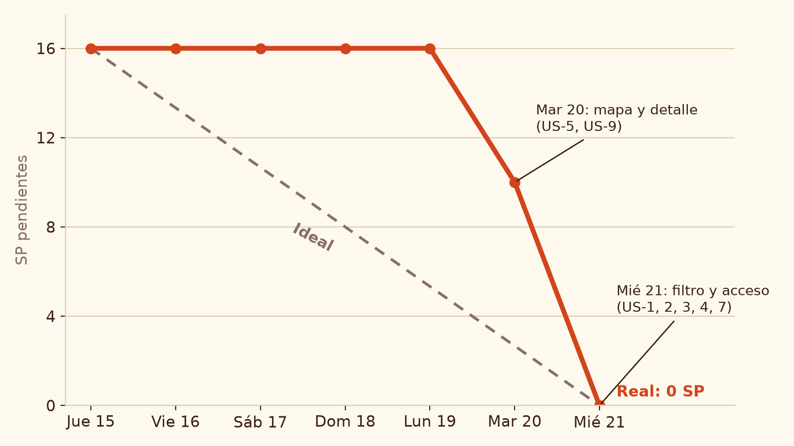
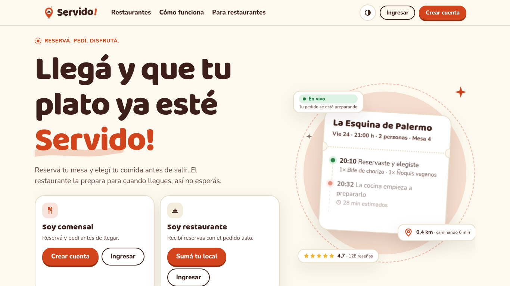
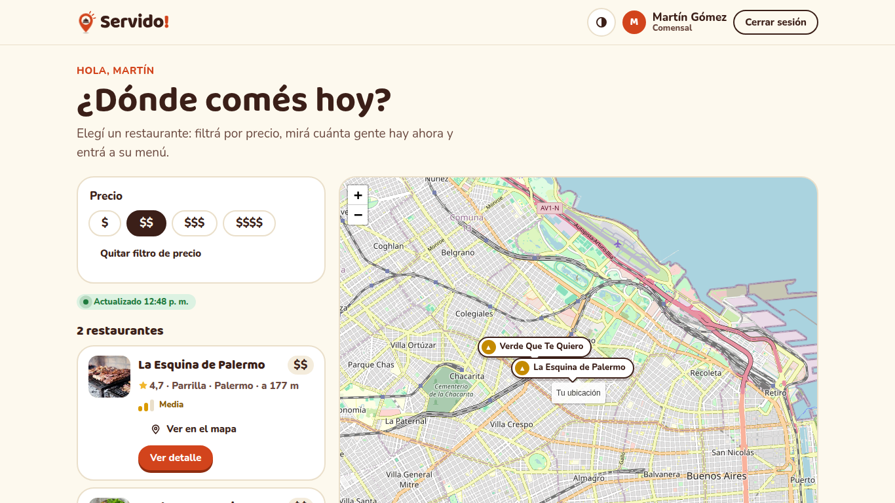
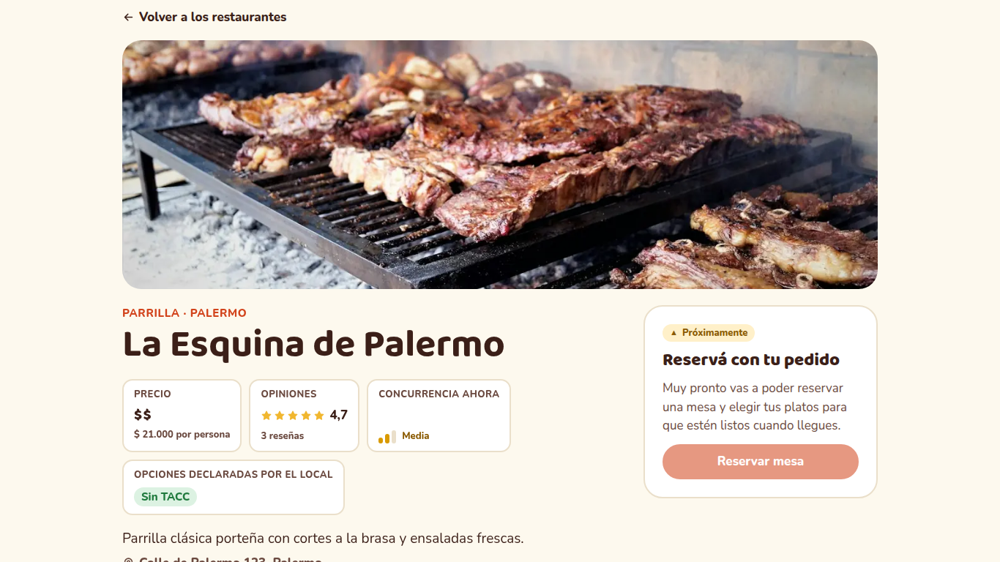
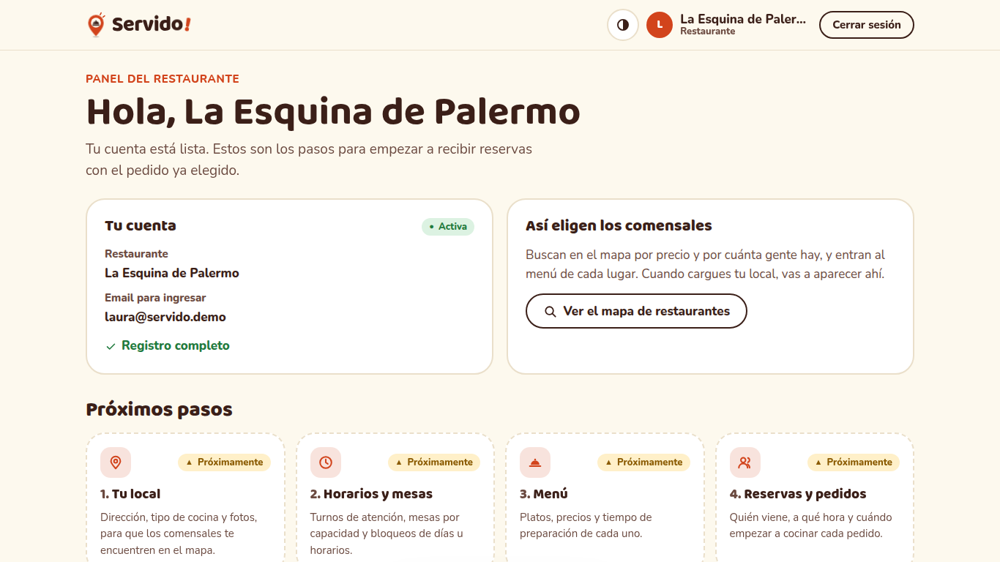

# Sprint 1 · Demo y retro (15/10 – 21/10)

PM del sprint: Mateo Alvarez. Defensa: miércoles 21/10, 19:00.

## Alcance

| US | Historia | SP | Estado | Pruebas automáticas |
| --- | --- | --- | --- | --- |
| 1 | Completar formulario de registro (comensal) | 3 | Hecha | 13 |
| 2 | Ingresar datos obligatorios para registrarme (restaurante) | 3 | Hecha, sin registro con Google | 10 |
| 3 | Ingresar usuario y contraseña (comensal) | 1 | Hecha | 11 |
| 4 | Ingresar usuario y contraseña (restaurante) | 1 | Hecha, sin el 403 por rol | 4 |
| 5 | Ver mapa de restaurantes | 5 | Hecha | 11 |
| 7 | Filtrar restaurantes por precios del menú | 2 | Hecha | 13 |
| 9 | Ver detalle de restaurante | 1 | Hecha | 5 |
| 33 | Ver listado de restaurantes (adelantada del Sprint 4) | 5 | Hecha | 4 |
| **Total** | | **21 de 16 planificados** | | **105** (28 backend, 77 frontend) |

**Carryover**: el registro con Google que el backlog menciona en US-2 pasa a US-28 (Sprint 4). El escenario 3 de US-4 (403 con el rol equivocado) se prueba cuando existan endpoints exclusivos de cada rol (Sprint 2). Ver [specs/README.md](../../../specs/README.md#decisiones-del-equipo).

## Métricas

- **Velocidad**: 21 SP terminados sobre 16 planificados (131 %), con US-33 adelantada.
- **Burndown**: plano hasta el lunes. El mapa entró el martes y el filtro y el acceso el miércoles, el día de la demo.
- **Pull requests**: 12 mergeados en el sprint (infraestructura, sistema de diseño, mapa, filtro, acceso, integración); 1 cerrado (demo).
- **CI**: 29 corridas, 26 verdes. Las 3 rojas eran pruebas desactualizadas o formato, y se corrigieron antes de mergear.
- **Producción**: la app corre en AWS desde el Sprint 1 (el plan lo preveía para el Sprint 2), con deploy automático en cada merge a `main`.

## Demo

URL: <https://d2hzxi2oo4z9in.cloudfront.net>. Cuentas de demo: una de comensal y una de restaurante (credenciales en la presentación).

| Paso | Qué se muestra | US |
| --- | --- | --- |
| 1 | Inicio sin sesión: tarjetas "Soy comensal" y "Soy restaurante" | 1, 2, 3, 4 |
| 2 | Crear cuenta de comensal con un dato inválido (el error indica qué corregir) y después válida | 1 |
| 3 | Ingresar con contraseña incorrecta (mensaje genérico) y después correcta; el ojo muestra la contraseña | 3 |
| 4 | Inicio del comensal: mapa con concurrencia, distancia y leyenda; listado al lado | 5, 33 |
| 5 | Filtrar por `$$`, cambiar a `$` y `$$`, quitar el filtro | 7 |
| 6 | Abrir un restaurante: precio, opiniones, fotos y menú con precios; volver con el filtro intacto | 9 |
| 7 | Cerrar sesión e ingresar como restaurante: su panel con los próximos pasos | 2, 4 |

## Retrospectiva

Borrador a partir de lo que muestra el repositorio; el equipo lo completa en la retro.

| Funcionó | Para mejorar | Acciones para el Sprint 2 |
| --- | --- | --- |
| Specs con decisiones registradas antes de codear | La integración se hizo el último día (burndown plano hasta el lunes) | Un PR chico a `main` por cada avance, desde el primer día |
| CI y la protección de `main` frenaron pruebas rotas antes de llegar a producción | La rama de acceso trabajó sin PR ni CI hasta el miércoles | Abrir el PR como borrador apenas se empieza una US |
| Deploy automático en AWS desde el Sprint 1 | Dos cambios de spec (contraseña, nombre) se hicieron sin pasar por la PO | Todo cambio de spec se registra en `specs/README.md` y lo valida la PO |
| SDD con agentes de IA permitió adelantar US-33 | Un PR sin la sección de uso de IA | Revisión cruzada obligatoria: 1 aprobación para mergear (ya activa) |

## Sprint 2 (22/10 – 28/10, 12 SP, PM: Santiago)

| US | Historia | SP | Spec |
| --- | --- | --- | --- |
| 6 | Ingresar nombre y características del local | 2 | [004](../../../specs/004-local-horarios-mesas/spec.md) |
| 8 | Definir horarios de atención | 2 | 004 |
| 10 | Marcar mesas disponibles | 2 | 004 |
| 11 | Crear reserva | 3 | [005](../../../specs/005-reservar-mesa/spec.md) |
| 12 | Agregar plato | 3 | [006](../../../specs/006-menu-platos/spec.md) |

La spec 005 tiene dudas abiertas para la PO (cantidad de comensales, elección de mesa, duración de la reserva, tipos de mesa, aprobación del restaurante).
